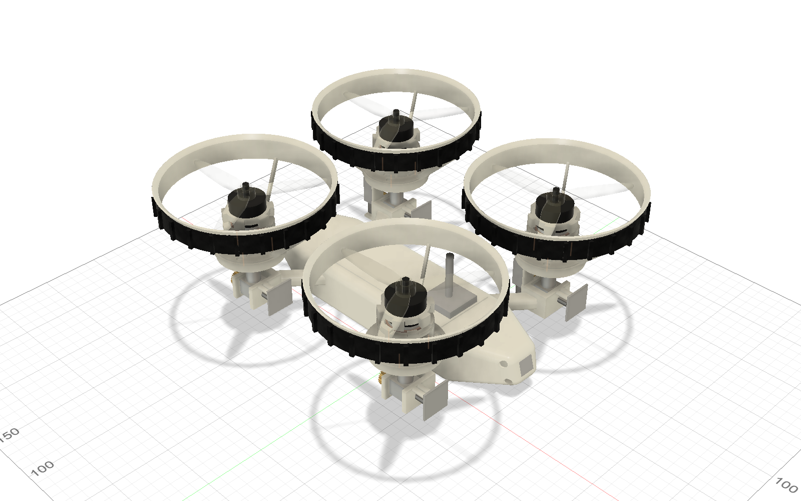
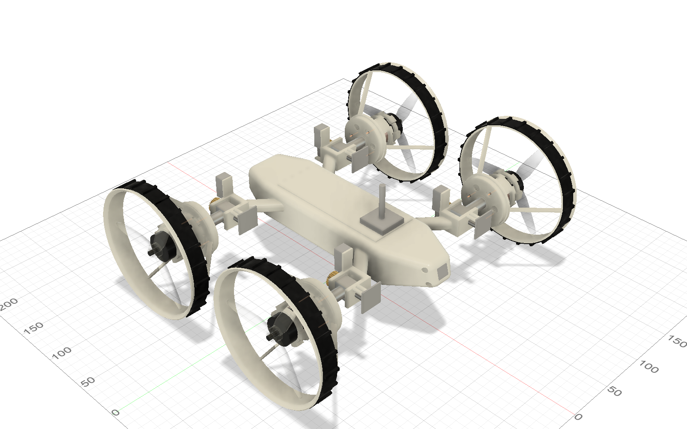

# Ringwheel – a drone whose prop ducts become wheels

A 5-inch FPV quadcopter that lands, folds its four ducts down by 90° and drives away on them. Each duct ring has a tread and turns into a wheel. The same four motors fly the drone and drive the wheels.

> **Status: design study.** Nothing here has been built, printed or flown yet. All dimensions, gear meshes and PCB traces are unverified until someone builds it. If you do, please open an issue and tell me what broke.

| Flight mode | Drive mode |
|---|---|
|  |  |

## How it works

- **Folding:** Each arm ends in a hinge. A small N20 gear motor turns it through a self-locking brass worm drive (1:30). An AS5600 magnetic sensor reads the angle, and fixed end stops limit the travel to 0° (flight) and 90° (drive).
- **Ring = wheel:** The duct around each 5.1" propeller has a TPU tread and runs on the hollow axle. In flight the ring is locked.
- **Drive train:** A sliding coupler on each motor axle switches between two positions. A solenoid coil pulls it one way, a spring pushes it back.
  - **Flight:** The coupler locks the wheel hub, so the ring stands still around the spinning prop.
  - **Drive:** The coupler engages the motor bell and drives the wheel through a 1:4 planetary stage (module 0.7, 24/24/72 teeth) inside the hub.
  - A Hall sensor (AH1806) and a small ring magnet confirm the coupler position.
- **Electronics:** A custom board (Hybrid-Controller HC-1, ESP32-S3) sits between the flight controller and the 4-in-1 ESC. A bus switch hands the four DShot signals either to the flight controller (flight) or to the ESP32 (drive). The board also runs the hinge motors and the solenoids. One small corner board per hinge (EP-1) carries the angle sensor and the wiring through the joint.
- **Safety logic:** Drive mode is only allowed while the flight controller reports *disarmed* and all four couplers report *engaged*. Folding only happens at standstill. See [electronics/README_Elektronik.md](electronics/README_Elektronik.md) (German) for the full sequence and pin map.

## Key data (from CAD)

| | |
|---|---|
| Props | 5.1" three-blade (Gemfan Hurricane 51466-3), duct inner Ø 130 mm |
| Motors | 4× 2306 2450 KV, 4S |
| Flight stack | 30 × 30 F722 + 55 A 4-in-1 ESC (Flywoo GOKU), ELRS receiver |
| Battery | 4S 1300 mAh |
| FPV | DJI O4 Air Unit Lite, camera in the wedge nose, tilted 15° |
| Hinge spacing | 170 × 160 mm |
| Mass | ≈ 950 g as modelled |
| Print materials | PA6-GF (frame, gears), TPU 95A (treads) |
| Parts cost | ≈ 910 € for the drone, ≈ 1,340 € including goggles, radio and charger (Germany, October 2026) |

## What is in this repository

| Path | Content |
|---|---|
| `cad/Drohne_Hybid_Car_v15.f3d` | Current Fusion design with joints and parameters (`klappwinkel` = fold angle, `muffe_weg` = coupler travel) |
| `cad/Drohne_Hybid_Car_v15.step` | The same assembly as STEP for other CAD tools |
| `cad/Drohne_Hybid_Car_v11_rounded_hull.f3d` | Older alternative with a rounded hull instead of the wedge nose |
| `electronics/` | KiCad 10 projects for HC-1 and EP-1, schematics as PDF, 3D models |
| `electronics/Fertigung/` | Gerber, BOM and placement files for JLCPCB |
| `docs/Kostenliste.md` | Full parts list with shop links and prices (German) |

The detailed docs are in German for now. Translations are welcome.

## Open points before anyone builds it

- **Firmware:** not written yet. The ESP32 logic and the flight controller setup are only specified in the electronics README.
- **Flight performance:** untested. The ducts and the drive train add weight, so the thrust-to-weight ratio needs a real measurement.
- **Gear teeth:** module 0.7 in PA6-GF should print with a 0.4 mm nozzle, but this needs a test print.
- **Hall sensor:** the energised solenoid may trigger the sensor. This needs a bench test, which is why the firmware also checks the coupler via motor RPM.
- **Camera mount:** published dimensions of the O4 Lite camera disagree. The mount has slots to compensate, but check it against the real part.
- **PCBs:** routing was generated automatically and passes DRC, but review it in KiCad before ordering, especially USB and the power paths. Match the ESC connector pinout to the stack you buy.

## Credits

- Inspired by [Michael Rechtin's transforming drone](https://www.youtube.com/watch?v=f1GSzysrYtw). No files from his project are used here.
- CAD modelling, PCB layout and documentation were done with heavy AI assistance (Claude by Anthropic). That is one more reason to check every dimension before printing.
- Footprints and 3D models from the KiCad libraries remain under their own license. Product names belong to their respective owners.

## License

© 2026 DesignStraub. Licensed under [CC BY-NC-SA 4.0](LICENSE): you may build, modify and share this design for non-commercial purposes, as long as you give credit and share your changes under the same license.

**Additional permissions** granted by the author on top of the license:

- You may publish videos, photos and articles about your own build, including monetised ones (ads, sponsorships). This does not cover selling files, kits, parts or finished drones.
- Schools, universities, makerspaces and non-profit clubs may use the design for teaching and workshops, including fees that only cover material costs.
- **Commercial use** (selling kits, parts or built drones, or using the design in a product): please ask first by opening an issue.

## Safety and legal

This design is provided as is, without any warranty. Building, flying and driving it is entirely at your own risk.

- LiPo batteries can catch fire. Charge them under supervision and store them in a fireproof bag.
- The props sit on the drive motors, so they also spin in drive mode. Keep fingers out of the ducts.
- In the EU, a privately built drone of this weight falls into the open category, subcategory A3. You need to register as an operator, pass the A1/A3 online test, keep away from people and stay 150 m from residential areas. FPV flight requires an observer next to you. In Germany, liability insurance is mandatory. Check the rules in your country before the first flight.

---

## Kurz auf Deutsch

Eine 5-Zoll-FPV-Drohne, deren Propellerringe nach der Landung um 90° nach unten klappen und zu Rädern werden. Dieselben vier Motoren treiben beim Fahren über eine Schaltmuffe und ein Planetengetriebe 1:4 die Räder an. Das Projekt ist eine Konstruktionsstudie und noch nicht gebaut. Die ausführliche Doku zu Elektronik und Kosten ist auf Deutsch: [electronics/README_Elektronik.md](electronics/README_Elektronik.md) und [docs/Kostenliste.md](docs/Kostenliste.md).

Lizenz: CC BY-NC-SA 4.0 mit den oben genannten Zusatzerlaubnissen. Privat nachbauen und verändern ist ausdrücklich erwünscht. Für kommerzielle Nutzung bitte vorher fragen.
